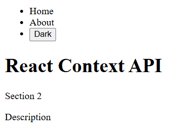
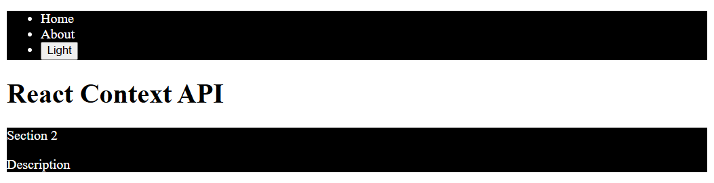

# React Fundamentals

A Vite and React page that shares a light or dark theme through context.

## Description

From this folder, `npm run dev` starts Vite. This run was Vite 8.2.1 at http://localhost:5173/. The tab title is **react-fundamentals**.

The page starts on the light theme. The list is Home, About, and a button labeled **Dark**. The heading is "React Context API". Under that, a section shows "Section 2" and "Description". Home and About are list items. The page does not set a font or a page background. In this browser the heading is Times New Roman at 32px, and the two paragraphs are Times New Roman at 16px. These shots are on white.

The nav and the section use the theme. On light, both are white with black text. The heading sits outside them, so it stays black either way. The button is the browser's default button, `rgb(240, 240, 240)`.

Clicking the button switches the theme. The label becomes **Light**. The nav and the section turn black, `rgb(0, 0, 0)`, and their text turns white. The heading stays black. Clicking **Light** returns the page to the first view, and the button reads **Dark** again.

## Screenshots

### Light theme



### Dark theme



## Getting Started

### Dependencies

* Node.js and npm
* This run used Vite 8.2.1

### Installing

```bash
npm install
```

### Executing program

```bash
npm run dev
```

This run opened http://localhost:5173/.

## Help

The heading sits outside the themed blocks, so it stays black in both themes. The button label is **Dark** on the light theme and **Light** on the dark theme.

## Authors

[Mamadou Moussa Balde](https://www.linkedin.com/in/2mb/)

## Version History

* Current local run
    * Vite 8.2.1 at http://localhost:5173/
    * Light theme first, then the dark theme after one click

## License

This folder does not include a `LICENSE.md` file.

## Acknowledgments

* [README template](https://gist.github.com/DomPizzie/7a5ff55ffa9081f2de27c315f5018afc)
